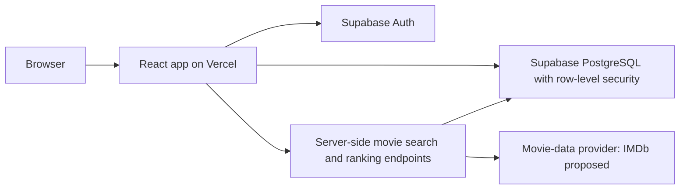

# Encore — living document

Status: initial design proposal. Update this document as decisions, experiments, and feedback evolve.

## Problem and idea

Star and numerical ratings can leave films tied even when a viewer prefers one. Encore asks users to compare films directly, producing an ordered personal list instead of a set of scores. Reviews and social discussion add context to those preferences, while recommendations help users discover unseen movies.

## Initial scope

The first usable version should let a user sign up, verify an email address, search for a movie, mark it watched, insert it into a personal ranking, and create or edit a review. Each user can have one review per movie. A watched movie may remain unranked until the user completes its comparisons.

Later increments add friendships, friends’ activity, comments, and recommendations. Global ratings, advanced machine learning, and native mobile apps are outside the initial scope.

## Proposed architecture

React handles search screens, the watched list, comparison prompts, and review forms. Supabase Auth handles accounts. PostgreSQL stores application data, with row-level security restricting writes to the owner. Server-side endpoints protect provider credentials and will enforce ranking transactions and matchup limits.

IMDb API access requires an AWS account and access through AWS Data Exchange. Confirm product availability, cost, licensing, and poster usage before integration; use sample movie data during prototyping. See [IMDb access documentation](https://data.imdb.com/documentation/api-documentation/getting-access/). Credentials must remain on the server.

## Data model

The starter migration defines:

| Table | Purpose |
| --- | --- |
| `profiles` | Public username associated with a Supabase Auth user |
| `movies` | Cached provider identifier, title, year, and optional poster URL |
| `watched_movies` | A user’s viewing history and optional ranking position |
| `reviews` | One editable review per user/movie pair |

Position 1 is the most preferred film. A uniqueness constraint prevents duplicate positions within a user’s ranked list. Reviews reference watched movies so a review requires a viewing record. The initial access model makes profiles and reviews visible to signed-in users and viewing history private to its owner; friends-only sharing needs a deliberate policy change.

Planned additions include friend requests/accepted friendships, review comments, ranking-session records, and an event log for matchup rate limits. These are design proposals, not implemented tables.

## Ranking design and experiment

Maintain a best-to-worst list. To add a movie, compare it with the middle movie of the remaining interval. If the user prefers the new movie, search the better half; otherwise search the worse half. Insert when only one possible position remains.

For a list of `n` ranked movies, at most `ceil(log2(n + 1))` comparisons are needed: up to 4 for 12 movies and up to 7 for 100. Empty lists need no comparisons. The prototype tests every possible insertion position for list sizes 0 through 128, including 12 and 100.

This bound assumes consistent answers and a stable existing ordering. Real preferences can change or be inconsistent. The first design uses strict ordering; ties and “cannot decide” behavior remain open questions. Canceling a comparison session should leave the stored ranking unchanged. Re-ranking removes the movie from its previous position and repeats insertion into the remaining list.

The terminal prototype uses Python to explore the algorithm independently of the proposed React frontend. It is not application code or a persistence layer.

Before integrating ranking, add a database transaction that locks the user’s ranking, checks a version, updates positions with deferred uniqueness checks, and commits the new order atomically. The starter schema does not implement that transaction. Concurrent sessions must either serialize or restart against the updated list.

## Social features and recommendations

Friendships should require acceptance. Friends can then browse shared rankings/reviews and discuss reviews through comments. Decide how blocking and deletion affect visibility before implementing these features.

Start recommendations with genre overlap from highly ranked movies and candidates ranked highly by accepted friends. Exclude watched movies, normalize friend rank by list length, and show a short explanation such as “similar to your top-ranked dramas.” Cold-start users can receive a small discovery list until enough preferences exist. Provider metadata and the final scoring rules are still undecided.

## Risks and feedback

- **Different list sizes:** verify insertion correctness for small and large lists; the comparison count grows logarithmically, but persistence and user fatigue still need evaluation.
- **Changing preferences:** allow users to edit reviews and re-rank films; do not assume rankings stay consistent forever.
- **Abuse:** require verified email for ranking writes and enforce 100 submitted matchups per user per rolling hour on the server. These controls are planned and are not present in the starter migration. They reduce automated abuse but cannot guarantee prevention.
- **Provider access:** confirm IMDb licensing and integration feasibility before making search depend on it.
- **Privacy and integrity:** test owner access, friend visibility, duplicate reviews, and concurrent ranking writes before releasing.

The supplied pitch ends mid-sentence after “We also plan on including an option of”; that unfinished feature is intentionally left undecided.

## Milestones

1. **Exploration — this starter:** document the idea; prototype binary insertion; draft the core database schema and local setup.
2. **Next design milestone:** finalize architecture, data relationships, privacy rules, API provider, comparison-session behavior, and initial screen flows.
3. **Core app:** create the React app; integrate Auth and search; persist viewing history, ranking transactions, and editable reviews.
4. **Social increment:** implement accepted friendships, shared activity, comments, and access policies.
5. **Discovery and release:** add basic recommendations, verify limits and deployment settings, and deploy the frontend to Vercel.

## Decisions to resolve next

- Movie provider access and poster licensing.
- Ties, skipped comparisons, and partially completed ranking sessions.
- Public versus friends-only rankings and reviews.
- Whether to store repeat viewings separately from the unique watched-movie record.
- Recommendation inputs and success criteria.

## Success checks

Users can place a new film in the intended position, including at the top or bottom; no ranking positions collide after simultaneous edits; reviews remain unique and editable; one user cannot edit another user’s records; recommended films exclude watched films. Validate the comparison flow with a few users before expanding scope.
